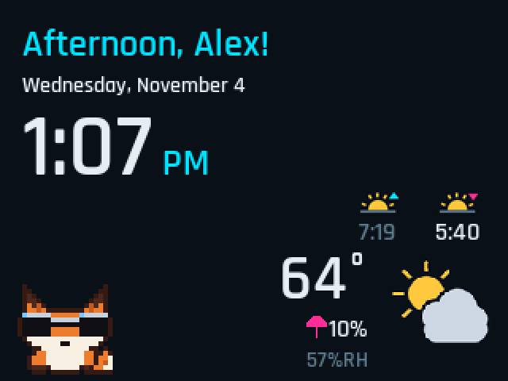
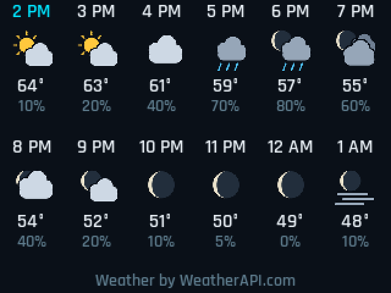
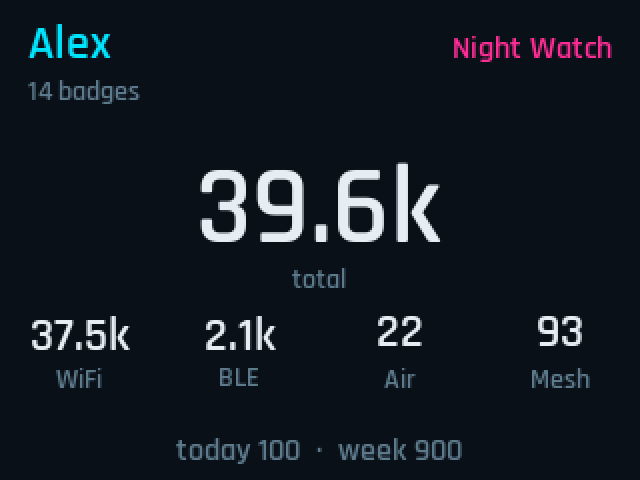
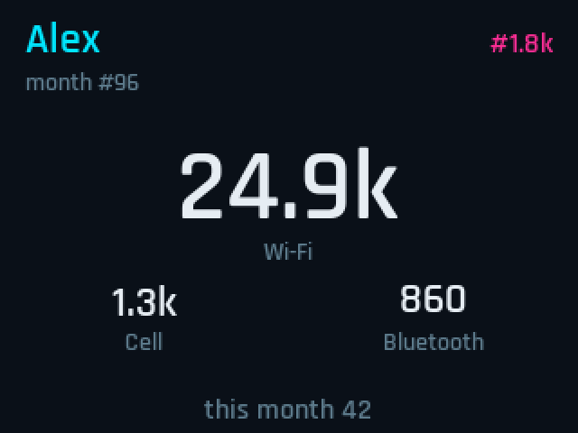
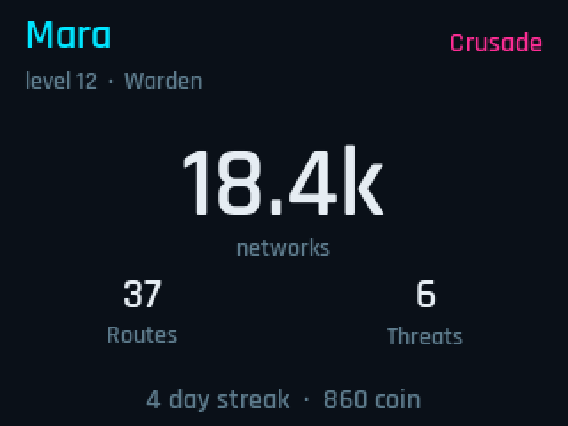
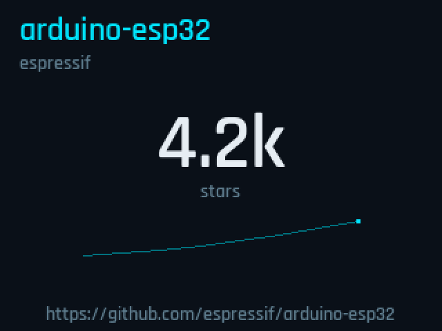
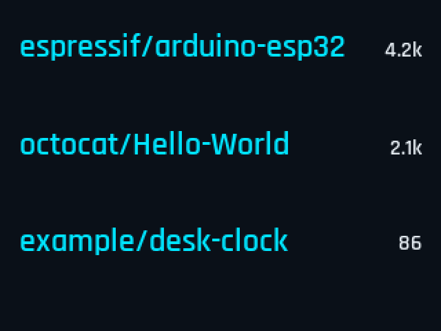
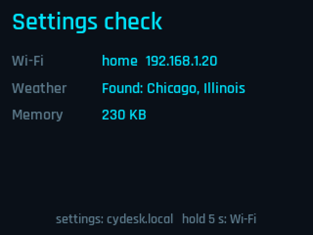

```
 ██████╗██╗   ██╗██████╗ ███████╗███████╗██╗  ██╗
██╔════╝╚██╗ ██╔╝██╔══██╗██╔════╝██╔════╝██║ ██╔╝
██║      ╚████╔╝ ██║  ██║█████╗  ███████╗█████╔╝ 
██║       ╚██╔╝  ██║  ██║██╔══╝  ╚════██║██╔═██╗ 
╚██████╗   ██║   ██████╔╝███████╗███████║██║  ██╗
 ╚═════╝   ╚═╝   ╚═════╝ ╚══════╝╚══════╝╚═╝  ╚═╝
```

A desk clock for the Cheap Yellow Display: a small ESP32 with a color touchscreen. It shows the time, the weather, a pixel pet, and a few optional accounts. Tap the screen to move to the next page. Hold for about five seconds to change the Wi-Fi network.

CYDesk supports the 2.8", 3.5" resistive, and 4.0" resistive Cheap Yellow Displays. The 2.8" board is the one that has been lived with day to day. The 3.5" and 4.0" builds use the same pages and settings on a 480×320 landscape panel; icons bump a little more on the 4" glass. Capacitive panels (ending in **C**), the no-touch E32N40T, and the Guition 480×480 ESP32-S3 (4848S040) are not supported.

## Put it on a board

Open the installer in **Chrome, Edge, or Firefox** on a computer (not a phone, and not Safari):

**[https://jazzactual.github.io/CYDesk/](https://jazzactual.github.io/CYDesk/)**

The same page installs a blank board and updates one that already runs CYDesk.

1. Plug the board in with a **data** USB cable. A charge-only cable will not show a port.
2. These boards use a **CH340** USB chip. Windows and Mac need the driver from [WCH](https://github.com/WCH-IC/download/releases/tag/CH341) before a port appears. Run `CH341SER.EXE` on Windows, or install `CH341SER_MAC.ZIP` on a Mac (allow it under System Settings → Privacy & Security if macOS asks). Linux already has the driver. Unplug the board and plug it back in after installing.
3. On the installer page, pick the size printed on the back of the board from the list, then **Install or update**. The port is usually named USB Serial, `usbserial`, or `wchusbserial`.
4. Leave **Erase device** unchecked unless you want a blank board. Erase clears the saved Wi-Fi and keys. An update with erase off keeps them.

Installing the wrong size will not damage the board. The picture will look wrong until you install the matching one.

### Update over Wi‑Fi (no laptop flash)

After the board is on your home Wi‑Fi and running a build that includes the update UI:

1. Open **http://cydesk.local** (or the IP on Status).
2. Scroll to **Firmware** → **Check for updates**.
3. If a newer build is listed, **Update now**. Watch the desk for progress; it reboots when done. Keep power on.

The board pulls `channel.json` + `app.bin` for its size (2.8 / 3.5 R / 4.0 R) from the same GitHub Pages site as the USB installer. The first time you move from an older "no OTA" image, use the USB installer once (erase still off) so the partition table gains a second app slot.

**Backups still work**

- USB installer with Erase unchecked (keeps Wi‑Fi and keys).
- PlatformIO espota from a computer on the same Wi‑Fi:

```
pio run -e e32r28t -t upload --upload-protocol espota --upload-port cydesk.local --upload-flags --auth=cydesk
```

Password is `cydesk`. Use `-e cyd35` or `-e cyd40` for those boards.

## Pages

Tap anywhere to go to the next one. It wraps around. After a page has been up for 30 seconds, a tap returns to Home. On Home, a tap still moves on. On the settings page, uncheck a screen to skip it. Status always stays in the cycle. If every other box is cleared, Home stays on.

1. **Home.** Greeting, date, and clock. The greeting follows the hour: morning, afternoon, evening, or "Up late". Sunrise and sunset sit above the weather, in time order, with the next one bright and the one that already passed muted. Temperature, the chance of rain, humidity, and a weather icon. By day the sun is drawn for clear and partly cloudy. At night every icon uses the moon phase from the forecast. The desk pet sits in the bottom-left corner.

   

2. **Hourly.** The next 12 hours as tiles: hour, icon, temperature, and chance of rain. The current hour uses the accent color. "Weather by WeatherAPI.com" sits along the bottom.

   

3. **Badge.** One [WDGWars](https://wdgwars.pl/) account: name, gang, badge count, total, Wi-Fi, BLE, aircraft, mesh, and today plus the last 7 days. Asks for a key when none is saved. Read-only. Refreshes about every 15 minutes. A failed check keeps the last numbers and marks them stale.

   

4. **WiGLE.** Rank, month rank, and discovery counts (Wi-Fi, cell, Bluetooth, and this month) from a read-only [WiGLE](https://wigle.net/) stats request. The API name and token are saved on the board. One successful check per day, at a time you pick (default 4:00). If the desk is off then, it checks the next time it is on. The last numbers stay up until the next check.

   

5. **Wardrift.** One [wardrift.net](https://wardrift.net/) character: name, faction, level, class, networks, routes, threats, and a streak when there is one. The upload API key cannot read the dashboard, so the desk signs in with the username and password. Read-only. Refreshes about every 15 minutes. A failed check keeps the last numbers and marks them stale.

   

6. **Stars.** The first public GitHub repo in the list, as a big star count, with the repo address along the bottom. A thin line of one point per day appears once two local days have been saved (up to about three weeks). No token. Public repos only, written as `owner/repo`.

   

7. **Repos.** The same repos as a list, name and count, once a second repo is saved. With only one, this page says to add another. Up to four repos. One request at a time, about every 15 minutes. A failed check keeps the last count.

   

8. **Status.** Whether Wi-Fi is up, the weather check, and how much memory is free for a download. This page cannot be turned off.

   

Big counts are shortened (1.2k, 12.5k, 1.25M). A page that is on but has nothing saved shows its empty message instead of disappearing. The pictures above use sample names and numbers.

## First boot

If the board has no Wi-Fi saved, it opens a network called `CYDesk`. Join that from a phone or computer and pick your own network. It has to be **2.4 GHz**. The portal only asks for the network. Everything else is on the settings page, because a phone closes that mini-browser as soon as you switch apps.

When it is on your Wi-Fi, the screen shows a QR code until setup is finished. The code opens the settings page on the board (also at `http://cydesk.local`, or the IP address printed on the screen). The QR code uses the IP address, because `.local` names can take a few seconds to look up.

Add at least:

- the name used in the greeting
- a ZIP code
- a free [WeatherAPI.com](https://www.weatherapi.com/signup.aspx) key

The rest of the settings page is optional. Password boxes start empty after a key is saved. Leave one blank to keep what is already stored.

Those stay on the board. They are not in this repo, and the keys and passwords are not printed in the serial log.

Two boards on the same Wi-Fi both answer to `cydesk.local`. The QR code uses the IP address, which still works.

Hold a finger on the screen for about five seconds any time you want to change the Wi-Fi network. A dropped link does not open the portal by itself. On a mesh, the board looks for any node of the saved network name, not only the first radio it joined.

## Desk pet

A small pixel animal in the corner of Home: fox, raccoon, owl, or bear, or none. Off, idle, or reacting. Reactions, in order: asleep at night, an umbrella when rain or snow is likely, sunglasses when it is clear, otherwise a blink or a small wiggle. The default, before you open settings, is a fox that reacts.

## Settings page

Served by the board at `http://cydesk.local` once it is on your Wi-Fi.

- Accent color. Default cyan. It replaces the highlights on the desk and on this page as you move the picker. Pink stays for errors, the umbrella, and the sunset arrow.
- Which screens a tap visits.
- Name, ZIP code, and WeatherAPI key. °F or °C. 12-hour or 24-hour clock. The clock's offset comes from the weather location, including daylight saving.
- WDGWars key.
- WiGLE API name, token, and the time of day to check.
- Wardrift username and password.
- Up to four public GitHub repos, one per line.
- Desk pet mode and animal.

Weather refreshes about every 15 minutes and covers the current conditions, sunrise and sunset, and the hourly page in one request.

## Boards

| Size | Board | Screen | Flasher choice |
| --- | --- | --- | --- |
| 2.8" | E32R28T / ESP32-2432S028 | 240×320, ILI9341 | 2.8 inch |
| 3.5" resistive | ESP32-3248S035**R** | 320×480, ST7796 | 3.5 inch R |
| 4.0" resistive | E32R40T / ESP32-32E | 320×480, ST7796 | 4.0 inch R |

On the taller boards, Home still anchors weather to the bottom-right (so the 2.8" clock block stays where it was approved), and the hero-stat pages (Badge, WiGLE, Wardrift, Stars) stretch their mid band instead of sliding a fixed 240 px strip down. Hourly tiles and the setup QR grow with the taller screen. The 4.0" R panel is the same pixel count as the 3.5" R; icons and the QR are a step larger for the bigger glass. If colours look swapped or touch feels dead after flashing 3.5" or 4.0", say so — those are the board quirks that still need a real panel to confirm.

## Build from source

[PlatformIO](https://platformio.org/). The 2.8" board is the default, so this flashes whatever is plugged in as a 2.8":

```
pio run -t upload
```

The taller boards are separate builds. Only use these when that board is the one plugged in:

```
pio run -e cyd35 -t upload
pio run -e cyd40 -t upload
```

`pio run`, `pio run -e cyd35`, and `pio run -e cyd40` also refresh the files the installer page serves. Pushing `main` publishes them.
